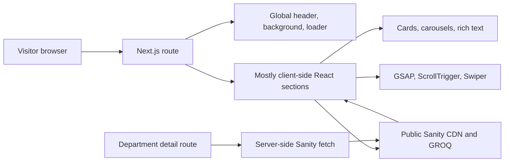

# BEM FISIP Unpad Website: 2026 Preparation and Technical Handover

Prepared on 3 September 2026 from the `development` branch at commit `7b1df0e`.

## Executive recommendation

Create a new GitHub repository for the 2026 website, keep this repository as a read-only 2025 archive, and migrate the existing feature set into a clean, currently supported foundation.

This should be a **controlled migration, not a completely new product**:

- Preserve the routes, CMS-driven features, and interactions the client wants.
- Reuse components or styling only after reviewing them.
- Do not copy the current dependency file, generated assets, Git workflow, or data-fetching architecture unchanged.
- Do not add 2026 content to the existing Sanity `production` dataset until the team has decided how the 2025 site will be archived. The current queries do not distinguish one year from another.

Suggested repository name: `bem-fisip-unpad-2026`.

The main reasons for a separate repository are:

1. The current GitHub default branch, `main`, contains only the initial commit. The working product is on `development`.
2. The old site should remain recoverable while the new site and content are being prepared.
3. The inherited project has security, performance, data-fetching, documentation, and maintainability debt that should not become the new baseline.
4. The codebase is small enough to migrate feature by feature without losing months of work.
5. A new repository gives the 2026 team clear ownership, clean deployment settings, reliable branch protection, and a useful history from day one.

If the deadline is extremely short, the fallback is still to create a new 2026 repository by copying the current `development` branch, then repair it there. Do not start 2026 work on the current stale `main` branch.

## What this application currently is

This is a public company-profile and publication website for BEM FISIP Unpad 2025. It has no user accounts, forms, payments, or custom API routes. Sanity is its external content database/CMS, while local files provide the 2025 visual identity and leadership images.

The public routes are:

| Route | Purpose | Main data source |
| --- | --- | --- |
| `/` | Home/landing page | Local branding plus Sanity |
| `/about` | Cabinet identity, values, team, and departments | Local branding/team images plus Sanity |
| `/article` | Latest articles/kajian and paginated archive | Sanity |
| `/post/[slug]` | Article or kajian detail | Sanity |
| `/hima` | Hima/Huria directory with Instagram links | Sanity |
| `/penjelasan/[birdep]` | Department/bureau details, programs, members, gallery | Sanity |

### Existing feature inventory

The client-requested parity baseline is:

- Global fixed header with desktop and mobile navigation.
- Global grainy blue background and page-load spinner.
- Full-screen/scroll-snap section presentation.
- Animated home hero and jump to the next section.
- Cabinet profile text and embedded profile video.
- Expandable flagship-program cards.
- Student-achievement (`Mapres`) carousel linking to Instagram.
- Press-release tiles linking to Instagram.
- Latest article/kajian cards and an archive with client-side pagination.
- Portable Text article/kajian pages with author, date, category, image, and Instagram link.
- Cabinet logo philosophy interaction and organizational-field marquee.
- Vision, mission, work culture, organizational values, and leadership carousel.
- Department/bureau directory and detail pages.
- Department programs, member carousel, and documentation gallery.
- Hima/Huria directory with outbound Instagram links.
- Responsive layouts for mobile and desktop.

This checklist should become the 2026 acceptance-test matrix. “Keep the same features” should mean every item is either preserved or explicitly waived by the client; it does not require retaining the same implementation.

## Technology stack

| Area | Current implementation |
| --- | --- |
| Framework | Next.js 15.4.2, App Router |
| UI runtime | React 19.1.0 and React DOM 19.1.0 |
| Language | TypeScript 5.x with strict mode enabled |
| Styling | Tailwind CSS 4 through PostCSS; `tailwind-scrollbar-hide` |
| CMS/data | Sanity project `w15vi3zr`, dataset `production`, GROQ queries, Sanity CDN |
| Rich text | `@portabletext/react` and a second Portable Text import from `next-sanity` |
| Images | Next.js `Image`, Sanity image URL builder, and some plain `` elements |
| Animation | GSAP with ScrollTrigger; Framer Motion for expandable program cards |
| Carousels | Swiper 11 |
| Fonts | Poppins and League Spartan through `next/font/google` |
| Package manager | npm with lockfile version 3 |
| Hosting | Vercel-oriented configuration in `vercel.json` |

The project does not declare a Node.js version. The audit build was run successfully with Node.js 22.14.0, but the 2026 repository should explicitly pin a supported Node LTS version using `engines` plus `.nvmrc` or `.node-version`.

### Dependency observations

Several direct dependencies appear unnecessary or mistaken:

- `tailwind` is a different legacy package, not Tailwind CSS. It is not used by the source and brings a large old server-side dependency tree.
- `motion` is installed but the code imports `framer-motion`, not `motion`.
- `i` is installed but unused.
- `@tailwindcss/line-clamp` is installed but not configured; line clamp is available in modern Tailwind CSS.
- Portable Text is imported through two packages. Standardize on one supported integration.
- Swiper imports `Pagination` in `MeetTheTeam` but does not include it in that Swiper's module list.

Do not run `npm audit fix --force` blindly. Remove unused packages first, choose compatible framework/CMS versions, upgrade in reviewable steps, and verify feature parity after each step.

## Repository and file map

```text
src/
  app/
    layout.tsx                    Global metadata, fonts, background, header, loader
    page.tsx                      Home route and custom scroll container
    about/page.tsx                About route and section composition
    article/page.tsx              Article/kajian listing route
    hima/page.tsx                 Hima/Huria route
    post/[slug]/page.tsx          Dynamic publication detail route
    penjelasan/[birdep]/page.tsx  Dynamic department route; server-side Sanity query
    components/                   Reusable cards, header/footer, logo, loader, carousel
    sections/                     Page-sized content and animation sections
    globals.css                   Tailwind import, theme variables, global colors
  sanity/client.ts                Hardcoded Sanity client and image URL builder
public/
  assets/img/                     2025 cabinet branding and photographs
package.json                      Scripts and dependencies
next.config.ts                    Sanity image host and development origins
vercel.json                       Vercel install/build/development commands
```

There is no Sanity Studio, Sanity schema source, test suite, CI workflow, environment example, operational runbook, content model documentation, or meaningful project README in this repository. The current `README.md` is the default Create Next App text and even refers to files and fonts that this project no longer uses.

## How the current runtime workflow works



### Global shell

`src/app/layout.tsx` loads both fonts, renders the grainy SVG background and fixed header, and wraps every route in `FullPageLoader`. The footer is not global; individual pages add it themselves.

`FullPageLoader` waits for the browser `load` event, not for Sanity content. It can disappear while CMS sections are still blank.

### Page scrolling and animation

Home and About create a viewport-height inner scrolling element instead of using normal document scrolling. They configure `ScrollTrigger.scrollerProxy`, pass the scroll element to child sections, and use CSS snap classes. Individual components then change global `ScrollTrigger.defaults` and create animations in `useEffect`.

This produces the intended presentation, but it tightly couples page layout, animation, and data arrival. Route cleanup also calls `ScrollTrigger.getAll().forEach(...kill())`, which affects all triggers rather than only those owned by that page.

### Content fetching

Most content is fetched in the visitor's browser after hydration:

- Home makes independent requests for profile/video, flagship programs, Mapres, press releases, and articles.
- About makes independent requests for vision, mission, work culture, values, and departments.
- `/article` fetches the latest six entries, while `MoreArticle` separately downloads the full archive again.
- `/post/[slug]` fetches the post in the browser.
- `/hima` fetches its directory in the browser.
- `/penjelasan/[birdep]` is the exception: its route fetches department content on the server and passes it into a client component.

There is no explicit revalidation policy, shared query layer, request error handling, retry policy, or content-not-found state.

### Build and deployment

The intended developer flow is:

```bash
npm install
npm run dev
npm run build
npm run start
```

Vercel is configured to run `npm install` and `npm run build`, then serve `.next`. The build command is `next build --no-lint`, so production builds intentionally skip linting. Use `npm ci` in CI/deployment for reproducible installs.

The Google fonts are downloaded during the production build. The audit build failed when external font access was blocked and succeeded when network access was allowed. Self-hosted/local font files would make builds more deterministic.

## Sanity beginner's guide

Sanity is probably the least familiar part of this stack, but its role is straightforward: **Sanity stores and manages editable content; Next.js decides how that content appears on the website.** Sanity is a headless content management system (CMS), which means its editing and data layer is separate from the public frontend.

### Sanity in 5W1H

| Question | Answer for this project |
| --- | --- |
| **What?** | A hosted content platform used for articles, kajian, departments, members, programs, Mapres, press releases, Hima/Huria, and general cabinet information. |
| **Why?** | It lets authorized editors publish or update content without editing TypeScript or redeploying the frontend for every change. |
| **Who?** | Administrators manage the project and access; editors manage content; developers maintain schemas, queries, integrations, and deployments; visitors only see published results. |
| **When?** | Editors use it when content changes. The website queries it when pages are built, requested, or loaded, depending on the route's fetching strategy. |
| **Where?** | Content lives in Sanity's hosted Content Lake. Editors work in Sanity Studio. This Next.js site reads the content and is deployed separately on Vercel. |
| **How?** | The frontend sends GROQ queries through a Sanity client, receives JSON, and renders the result as React components. |

### The mental model

Think of the system as three applications/services rather than one:

```text
Sanity Studio (admin/editor interface)
          ↓ publishes documents
Sanity Content Lake (hosted content database)
          ↓ queried with GROQ
Next.js website (public presentation)
```

Changing Studio code changes the editing experience and validation rules. Publishing a document changes hosted content. Changing Next.js code changes how content is queried or displayed. These are related operations, but they are not the same deployment.

### Essential terminology

| Term | Beginner-friendly meaning |
| --- | --- |
| **Project** | The top-level Sanity resource containing datasets, members, API configuration, CORS settings, and Studios. This frontend currently points to project `w15vi3zr`. |
| **Dataset** | An isolated collection of content inside a project, similar to a named database. This frontend currently uses `production`. |
| **Content Lake** | Sanity's hosted data service where documents and asset references live. It is not stored inside this Git repository. |
| **Sanity Studio** | The web admin/editor application used to create, edit, preview, and publish content. Studio itself is configured with code. |
| **Schema** | Code defining a content type, its fields, validation, preview, and editor behavior. For example, an article schema can require a title, slug, cover image, and author. |
| **Document** | One content record, such as one article, one Hima, or one department. Documents have system fields including `_id`, `_type`, `_createdAt`, and `_updatedAt`. |
| **Field** | One value inside a document, such as `title`, `publishedAt`, or `instagramLink`. |
| **Reference** | A relationship from one document to another. This project uses references to associate `anggota` documents with a department. |
| **Asset** | An uploaded image or file stored and delivered by Sanity. A document normally stores a reference to the asset rather than the binary itself. |
| **GROQ** | Sanity's query language. It filters, sorts, projects, and joins documents to return only the needed JSON. |
| **Draft** | An unpublished working version visible to permitted editors. Public visitors should normally receive only published content. |
| **Published document** | The version available through normal public queries and therefore visible on the website. |
| **CDN** | A cached, geographically distributed read layer. This project sets `useCdn: true` for fast public reads. |
| **Token** | A secret credential used for authenticated API access. A project ID is not a secret, but tokens are. |

### What is and is not in this repository

This repository contains a read client in `src/sanity/client.ts` and GROQ queries inside frontend components. That is enough for the public site to retrieve a public dataset.

It does **not** contain:

- `sanity.config.ts` or `sanity.cli.ts`;
- schema definitions such as `schemaTypes/`;
- the Sanity Studio application;
- a script for starting Studio;
- content migrations or dataset backup procedures; or
- documentation identifying the current Sanity owner.

Therefore, running `npm run dev` in this repository starts only the Next.js site at `http://localhost:3000`. It does not open a Sanity administration page.

### How to obtain administrator access

1. Go to [sanity.io/manage](https://www.sanity.io/manage) and sign in with the account your team intends to retain.
2. Ask an existing administrator to invite that exact account to project `w15vi3zr` with the **Administrator** role.
3. Open the project and confirm that the configured dataset is `production`.
4. Check the project's **Studios** section for an already deployed Studio and open it if one exists.
5. Confirm that you can see expected types such as articles, kajian, departments, members, Mapres, programs, and Hima/Huria.
6. Request the Studio/schema source repository even if the deployed Studio works. The source is required for safe maintenance and recovery.

Knowing the project ID does not grant administration access. An existing administrator must invite the new account. Sanity's Administrator role has read/write access to datasets and full project-setting access, including members, datasets, API settings, and CORS. See the official [roles guide](https://www.sanity.io/docs/user-guides/roles).

Use the same authentication method associated with the invitation. Sanity treats Google, GitHub, and email/password logins as separate accounts even when they use the same email address.

### How to run the website and Studio locally

After the previous team provides the Studio source, the normal setup uses two terminals:

```powershell
# Terminal 1: public Next.js website
cd C:\AIDAN\BEMFisipUnpad
npm install
npm run dev
# Open http://localhost:3000
```

```powershell
# Terminal 2: separate Sanity Studio repository/folder
cd C:\path\to\sanity-studio
npm install
npm run dev
# Open http://localhost:3333
```

For a CLI-created Studio, `npx sanity dev` is an alternative to `npm run dev`. Sanity Studio uses port 3333 by default. See the official [Studio development guide](https://www.sanity.io/docs/studio/development).

Do not run `npm create sanity@latest` inside this frontend merely to gain admin access. That command creates/configures Studio source; it does not grant a role, recover the previous schemas, or make the logged-in user an administrator. It is useful only after the team deliberately decides where the 2026 Studio will live and has recovered or recreated the correct schemas. See the [Studio installation guide](https://www.sanity.io/docs/studio/installation).

### How a content request works

The frontend creates a client:

```ts
const client = createClient({
  projectId: "w15vi3zr",
  dataset: "production",
  apiVersion: "2024-01-01",
  useCdn: true,
});
```

A component then requests content using GROQ:

```ts
const query = `
  *[_type == "artikel"] | order(publishedAt desc) {
    title,
    slug,
    author,
    publishedAt
  }
`;

const articles = await client.fetch(query);
```

Read the query from left to right:

1. `*` means all documents.
2. `[_type == "artikel"]` keeps only article documents.
3. `order(publishedAt desc)` puts the newest first.
4. `{ ... }` selects only the listed fields.
5. `client.fetch()` sends the query and returns JSON.

React then maps that JSON into cards or page content. A typical response resembles:

```json
[
  {
    "title": "Example Article",
    "slug": { "current": "example-article" },
    "author": "BEM FISIP Unpad",
    "publishedAt": "2026-09-03T08:00:00Z"
  }
]
```

### How publishing works for an editor

```text
Editor creates or changes a document in Studio
              ↓
Studio validates required fields and formats
              ↓
Editor saves a draft and requests review
              ↓
Authorized editor publishes
              ↓
Content Lake stores the published version
              ↓
Next.js receives it immediately or after cache revalidation
```

For 2026, define who may draft, review, publish, change schemas, manage datasets, and manage members. Administrator access should be limited to the people who actually need infrastructure control; ordinary content editors should receive the least-privileged role available on the client's plan.

### Sanity safety rules for this project

- Back up/export the 2025 dataset before changing schemas, datasets, or content.
- Do not enter 2026 content into the existing dataset until term isolation is decided.
- Do not delete or migrate documents while learning the interface. Practice in a separate development/2026 dataset.
- Never commit API tokens to Git or expose them in a `NEXT_PUBLIC_` environment variable.
- A project ID and public dataset name are identifiers, not passwords.
- Keep Studio schemas and migrations in Git and review them like other code.
- Use required fields, URL validation, image-alt fields, unique slugs, and explicit ordering in schemas.
- Use drafts and client approval before publishing production content.
- Add the new website/Studio origins to Sanity CORS settings only when required; enable credentials only for an authenticated Studio origin.
- Maintain at least two recoverable institutional administrators rather than relying on one student's personal account.
- Record dataset exports, schema changes, and launch-time content decisions in the handover.

### Recommended Sanity layout for 2026

```text
Sanity project (client/institution owned)
├── production       2025 archive; no new 2026 records
├── production-2026  approved 2026 public content
└── development-2026 optional safe testing content

Studio source repository
├── schemaTypes/
├── sanity.config.ts
├── sanity.cli.ts
└── migrations/

Next.js 2026 repository
├── read-only Sanity client
├── typed GROQ queries
├── preview/revalidation integration
└── no write token in browser code
```

Use separate `development-2026` and `production-2026` datasets only if the plan and team capacity support maintaining both. The non-negotiable requirement is that 2026 content must not accidentally mix with the 2025 archive.

### Suggested learning sequence

1. Open the existing deployed Studio as a Viewer first and inspect documents without changing them.
2. Learn the relationship between a schema type, one document, and its fields.
3. Read several existing GROQ queries in this frontend and compare their selected fields with Studio documents.
4. In a non-production dataset, create a test document, save it as a draft, preview it, publish it, and query it.
5. Learn references, Portable Text, image assets, slugs, validation, and ordering.
6. Only then plan the 2025 backup and 2026 content migration.

Useful official starting points:

- [Sanity Studio setup](https://www.sanity.io/docs/setting-up-your-studio)
- [Sanity Studio development](https://www.sanity.io/docs/studio/development)
- [Roles and permissions](https://www.sanity.io/docs/user-guides/roles)
- [Studio installation](https://www.sanity.io/docs/studio/installation)

## Sanity content model inferred from the application

The repository does not contain the authoritative Sanity schemas. The following contract is inferred from GROQ queries and TypeScript interfaces. A read-only type query against the configured public dataset confirmed these document types: `anggota`, `artikel`, `depBirPimKab`, `gambaranUmum`, `hima`, `kajian`, `mapres`, `megaproker`, `pressRelease`, `sanity.imageAsset`, and `visiMisi`.

| Sanity type | Fields consumed by this website |
| --- | --- |
| `gambaranUmum` | `titleVideoProfile`, `deskripsiKabinet`, `linkVideoProfile`, `judulVisi`, `pernyataanVisi`, `penjelasanVisi[]`, `poinMisi[]`, `poinBudayaKerja[]`, `poinNilai[]` |
| `megaproker` | `_id`, `title`, `description`, `image` |
| `mapres` | `title`, `image`, `instagramLink` |
| `pressRelease` | `image`, `slug`, `instagramLink` |
| `artikel` / `kajian` | `title`, `slug`, `image`, `body`, `author`, `publishedAt`, `category`, `instagramLink` |
| `depBirPimKab` | `_id`, `name`, `bidang`, `UnitImage`, `deskripsi`, `proker[]`, `dokumentasi[]` |
| `anggota` | `name`, `position`, `order`, `image`, plus a reference to its department |
| `hima` | `namaHima`, `logoHima`, `instagramHima` |
| `visiMisi` | Present in the dataset but unused by this codebase |

Important CMS behavior:

- `gambaranUmum` is treated as a singleton using `[0]`, but no fixed document ID or year filter is used.
- Department members are reverse-queried through references to a `depBirPimKab` document.
- Articles and kajian use both separate `_type` values and a `category` field, creating two sources of truth.
- Department order is partly imposed in browser code through hardcoded `bidang` values.
- The Sanity project ID, dataset, and API date are hardcoded in source instead of environment configuration.
- The website has read access only. Content must be created through a separate Sanity Studio or Sanity's hosted management interface.

### Critical content-migration warning

Do not simply create a second `gambaranUmum` record for 2026 in the existing `production` dataset. Queries such as `*[_type == "gambaranUmum"][0]` have no year or deterministic singleton ID and may return the wrong cabinet. Other content queries also have no year filter.

Choose one of these before entering 2026 content:

1. **Recommended:** use a separate Sanity dataset such as `production-2026`, after backing up the 2025 dataset and obtaining the real Studio/schema repository.
2. Use a separate Sanity project for full operational separation.
3. Add a `year`/`term` model and update both old and new applications to query it explicitly. Do this only if both websites will intentionally share one dataset.

The first option usually balances separation with manageable account administration.

## Audit results

### What passed

- `npm run build` completed successfully with network access.
- Next.js TypeScript validation passed during the production build.
- All seven application routes were generated or recognized.
- The Git worktree was clean before this report was added.

### Measured baseline

| Measurement | Result |
| --- | --- |
| Home first-load JS | 266 kB |
| About first-load JS | 1.36 MB |
| Article listing first-load JS | 229 kB |
| Department detail first-load JS | 246 kB |
| Post detail first-load JS | 200 kB |
| `Logo.tsx` source size | 1,550,198 bytes |
| Local image assets | 37 files, 35.47 MiB |
| Largest local photo | 7.86 MB |
| Packed Git object size | 38.63 MiB |
| Commits on `development` | 31 |
| Lint result | Failed: 25 errors and 12 warnings |
| Production dependency audit | 68 advisories: 5 critical, 38 high, 18 moderate, 7 low |

The dependency audit is a point-in-time tool result, not proof that every transitive advisory is reachable in the deployed application. It is still a release blocker until the direct critical packages and their dependency paths are reviewed and upgraded.

At the audit date, the installed framework is Next.js 15.4.2 while npm reports Next.js 16.3.4 as latest; React is 19.1.0 versus 19.2.8; `next-sanity` is 10.0.10 versus 13.3.4; Swiper is 11.2.10 versus 14.2.0. These are major-version migrations in several cases and should be tested, not mass-updated.

## Critical findings and required actions

### P0: resolve before entering or launching 2026 content

#### 1. CMS ownership and schemas are missing

The frontend depends on a hardcoded external Sanity project, but this repository does not contain the Studio or schema definitions. Without owner/admin access and the schema source, the 2026 team cannot safely reproduce, migrate, validate, or recover the content system.

Required action:

- Obtain Sanity organization/project access from the 2025 team or client.
- Locate the Sanity Studio/schema repository.
- Export and securely retain a 2025 dataset backup before changes.
- Document the dataset, CORS origins, deployment URL, editors, and recovery owner.
- Create a 2026 dataset/project strategy before editing content.

#### 2. Production dependency tree contains critical advisories

The audit includes critical findings in direct runtime packages such as Next.js and Swiper, plus many transitive findings. The accidental direct `tailwind` package introduces a particularly old and unnecessary dependency tree.

Required action:

- Remove unused/mistaken packages first.
- Move to supported patched versions of Next.js, React, Swiper, Sanity integrations, and build tooling.
- Run the audit again after a clean `npm ci`.
- Review remaining advisories for runtime reachability and record accepted exceptions.
- Add Dependabot or Renovate and a recurring maintenance owner.

#### 3. Two About sections continuously refetch data

The data-fetching effects in `sections/BudayaKerja.tsx` and `sections/Nilai.tsx` have no dependency array. Each fetch updates state, triggers a render, and starts another fetch. This can repeatedly hit Sanity, waste visitor bandwidth, affect quotas, and destabilize the page.

Required action: add a correct one-time/server-side query architecture rather than only patching the arrays. At minimum, these effects require `[]` and error cancellation/handling.

#### 4. The year is not represented in the content model

The frontend assumes one current cabinet. Adding 2026 records into the same types can make the 2025 application return mixed or arbitrary content.

Required action: isolate the 2026 dataset or introduce a deliberate term/year model across both applications.

#### 5. Git's default branch is not the deployed application baseline

`origin/HEAD` points to `main`, and `main` contains only an initial commit. The real work is on `development`. This makes cloning, onboarding, automation, and emergency recovery error-prone.

Required action: use a new repository with a production-ready `main`, or repair the branch model before any reuse.

### P1: fix during the parity migration

#### Performance and architecture

- `components/Logo.tsx` embeds large raster data inside JSX/base64, making `/about` exceptionally heavy. Replace it with optimized real SVG paths or external AVIF/WebP assets.
- `public/assets/img/logo/logo.svg` is also about 1.54 MB, and several photos are 2–8 MB. Re-export visual assets at display-appropriate dimensions and formats.
- Almost all routes and sections are client components. Content arrives only after hydration, reducing initial content, resilience, and SEO value.
- The Article page queries six latest posts and then separately queries the entire archive. Fetch once on the server or use server pagination.
- About separately queries different fields from the same `gambaranUmum` document. Fetch a typed page payload once.
- Sanity image URLs are requested without width, height, quality, or automatic-format transformations. Define reusable image helpers and correct `sizes` values.
- The full-page loader tracks the window load event rather than actual route/content readiness.

#### Correctness and resilience

- The Home latest-content query only requests `_type == "artikel"`; the dataset also has a distinct `kajian` type, so kajian can be omitted from the Home section.
- There are no `try/catch`, visible error states, or retry actions for client fetches.
- A nonexistent post leaves `/post/[slug]` on the loading state forever instead of returning a 404.
- Some code calls `urlFor` even when an image can be missing, which can throw instead of displaying a fallback.
- The fallback path uses `FILSFisip.jpg`, but the repository contains `FILSFisip.JPG`. This case mismatch can fail on Linux hosting.
- Department links are written as relative `penjelasan/...` links. They work only under the current trailing-slash/base-path behavior; make them absolute as `/penjelasan/...` and encode a stable slug instead of using a display name.
- `PenjelasanDepBir` creates a scroller ref but never attaches it to an element, so child scroll-triggered animations do not receive a working scroller.
- `ScrollTrigger.defaults` is shared globally, while page cleanup kills every registered trigger. Scope animation ownership to each component/page.
- `PRandArticle` calls two fetch functions through a comma expression. It currently calls both, but should use a clear `Promise.all` or separate statements.

#### Styling and responsive behavior

- Font setup uses `poppins.className` and `leagueSpartan.className`, while Tailwind theme utilities expect CSS variables. Use the fonts' `.variable` values or one intentional body class.
- Global CSS defines unused Geist variables left from the starter template.
- Dynamic Tailwind class construction such as `md:text-${align}` is not statically discoverable. Map each alignment to a complete class string.
- Several nonstandard or suspect utilities (`h-hvw`, fixed widths, negative offsets) should be checked across real phones.
- Scroll snapping and nested viewport scrolling can fight browser address bars, keyboard navigation, focus movement, and iOS behavior. Prefer document scrolling or make snapping a progressive desktop enhancement.
- Autoplay and animation do not honor `prefers-reduced-motion`.

#### Accessibility and UX

- Clickable program cards use `<div onClick>` without button semantics or keyboard handling.
- The hamburger button has no accessible name, `aria-expanded`, or `aria-controls`.
- Some information appears only on hover, which does not translate to touch or keyboard use.
- Swiper autoplay should be pausable and should stop for reduced-motion users.
- Empty CMS arrays produce blank sections instead of meaningful empty states.
- The root document declares `lang="en"` although most operational content is Indonesian; use `id` or a deliberate bilingual strategy.
- Heading order, focus indicators, image alternative text, color contrast, and focus behavior after route changes need an accessibility review.

#### Links, identity, and content

- All four footer social icons currently use `href="#"`.
- Header wording differs between desktop (`Artikel dan Kajian`) and mobile (`Article`).
- Branding and logo-philosophy copy are hardcoded for the 2025 cabinet.
- Seven leadership images and role labels are hardcoded under `public/assets/img/pimkab`.
- Field names/order, cabinet logo, hero wordmark, fallback/loading marks, and footer identity are also 2025-specific.
- External URLs from Sanity should be validated as HTTPS/known destinations before rendering.

#### SEO and sharing

- Only one global title and description exist, and both say 2025.
- There is no route-specific metadata for posts/departments, Open Graph image, Twitter card, canonical URL, sitemap, robots configuration, or structured data.
- Client-fetched post/list content limits the usefulness of server-rendered metadata.

#### Quality controls and documentation

- The lint task currently fails, while the build explicitly skips lint.
- Types frequently use `any`, including Sanity images, Portable Text, route params, and article state.
- There are no automated unit, integration, end-to-end, link, accessibility, or visual tests.
- There is no GitHub Actions workflow or required pull-request check.
- Commit messages and emergency merge history do not provide a dependable handover record.

## Recommended 2026 architecture

Retain Next.js, TypeScript, Tailwind, Sanity, and Vercel unless the client has a strong operational reason to change them. They fit this site. Improve how they are used:

1. Use Server Components for content pages and keep small client islands only for the menu, carousel, expandable cards, and animation.
2. Put every GROQ query and response type in a central `sanity/queries` layer.
3. Use explicit caching/revalidation, plus a Sanity webhook to revalidate published content if near-immediate updates are required.
4. Use `generateStaticParams` or on-demand rendering for post and department slugs, with `notFound()` for missing content.
5. Prefer stable slugs/IDs for routes. Never make a display name the database key or URL contract.
6. Use one publication type with a validated `category` field, or keep two types and derive the category from `_type`; do not maintain both sources of truth.
7. Put cabinet identity and leadership content in Sanity if non-developers need to update it. Keep foundational UI tokens and truly fixed institutional assets in code.
8. Move Sanity configuration into validated environment variables.
9. Use normal document scrolling where possible. Keep animation scoped and optional, and support reduced motion.
10. Optimize images at ingestion and request transformed Sanity images at the rendered size.

Suggested environment contract:

```dotenv
NEXT_PUBLIC_SANITY_PROJECT_ID=
NEXT_PUBLIC_SANITY_DATASET=production-2026
SANITY_API_VERSION=2026-09-01
NEXT_PUBLIC_SITE_URL=
```

Only introduce `SANITY_READ_TOKEN` if the dataset is private and all token-using queries run on the server. Never expose a read/write token through a `NEXT_PUBLIC_` variable.

## Suggested new repository structure

```text
src/
  app/
    (site)/
      page.tsx
      about/page.tsx
      article/page.tsx
      post/[slug]/page.tsx
      hima/page.tsx
      department/[slug]/page.tsx
    error.tsx
    not-found.tsx
    sitemap.ts
    robots.ts
    layout.tsx
  components/
    layout/
    sections/
    ui/
  sanity/
    client.ts
    image.ts
    queries/
    types/
  content/
    site-config.ts
  styles/
tests/
  e2e/
  unit/
.github/workflows/ci.yml
.env.example
.nvmrc
README.md
```

The exact folders are less important than separating routes, reusable UI, CMS contracts, and annual content.

## 2026 execution plan

### Phase 0: ownership and preservation

- Confirm the client-approved feature list using the inventory above.
- Identify who owns GitHub, Sanity, Vercel, the production domain/DNS, institutional email, and social accounts.
- Record the current production URL and deployment project.
- Export/backup the Sanity 2025 dataset and preserve Vercel environment settings.
- Mark this repository and the 2025 dataset as archived/read-only after backups are verified.
- Collect the 2026 brand guide, logo source files, organization structure, leadership data, programs, official links, and publication workflow.

Exit condition: the team can recover the 2025 site and has authority to operate every 2026 dependency.

### Phase 1: clean foundation

- Create `bem-fisip-unpad-2026` with a protected `main` branch.
- Scaffold a supported stable Next.js/React/TypeScript/Tailwind baseline.
- Pin Node and npm expectations.
- Add `.env.example`, a real README, and local setup instructions.
- Add CI for clean install, lint, typecheck, tests, and production build.
- Connect Vercel previews to pull requests; deploy production only from `main`.
- Configure the 2026 Sanity dataset/project and its allowed CORS origins.

Exit condition: an empty baseline builds reproducibly locally and in CI/Vercel.

### Phase 2: CMS contract and shared shell

- Recover and version the Sanity schemas.
- Add stable slugs, required-field validation, URL validation, ordering, image alternative text, and year/term isolation.
- Implement typed queries, image helpers, caching, error states, and preview strategy.
- Build the global header, footer, site metadata, theme tokens, and optimized branding.
- Populate a small set of fixture/draft content for development.

Exit condition: editors can create every needed content type without touching code.

### Phase 3: migrate feature parity by route

Suggested order:

1. Home shell, profile video, programs, Mapres, press releases, latest publications.
2. About identity, vision/mission/culture/values, leadership, departments.
3. Department detail, members, programs, and gallery.
4. Article/kajian archive and detail pages.
5. Hima/Huria directory.
6. Animation and scroll enhancements after the static/responsive experience is correct.

For each route, test loading, empty, error, long-content, missing-image, keyboard, reduced-motion, mobile, and desktop states.

### Phase 4: content migration and editorial review

- Enter 2026 content in the isolated dataset.
- Have each responsible BEM division approve its names, roles, programs, links, spelling, images, and privacy consent.
- Verify all article dates/categories/slugs and social destinations.
- Compress or transform every uploaded image and define focal points/crops.
- Preview the site using the final domain configuration.

Exit condition: the client signs off on content, not only layout.

### Phase 5: release readiness

- Run lint, typecheck, unit tests, Playwright route/link tests, accessibility checks, and a clean production build.
- Run `npm audit --omit=dev` and document any accepted residual risk.
- Check Core Web Vitals/Lighthouse on representative mobile and desktop devices.
- Test Chrome, Firefox, Safari/iOS, and Android Chrome.
- Verify metadata, sharing previews, sitemap, robots, analytics consent, and 404/error pages.
- Rehearse the domain cutover and rollback process.
- Tag the accepted release and export the final CMS dataset.

Exit condition: all required checks pass and there is a named rollback owner.

## Recommended two-person Git workflow

For a two-person team, a long-lived `development` branch is usually unnecessary. Use:

- `main`: always releasable; protected; production deployment source.
- Short-lived branches such as `feat/home-programs`, `fix/mobile-menu`, or `content/department-slugs`.
- One pull request per focused change.
- The other teammate reviews before merge.
- Vercel preview link included in the pull request.
- Squash merge with a clear conventional commit message.
- Required CI checks: install, lint, typecheck, tests, build.
- Release tag such as `2026-launch` after client acceptance.

Keep content changes in Sanity under an editorial workflow, with named reviewers and dataset exports at milestones. Code review does not replace content approval.

## 2026 content replacement checklist

- [ ] Site title, description, Open Graph image, canonical domain, and 2026 term.
- [ ] Cabinet name, logo, wordmark, colors, typography, and logo philosophy.
- [ ] Profile heading, cabinet description, and profile-video embed URL.
- [ ] Vision statement and explanatory points.
- [ ] Mission points and icons.
- [ ] Work-culture points.
- [ ] Organizational values.
- [ ] Leadership names, positions, order, photos, alt text, and publication consent.
- [ ] Fields/departments/bureaus, their order, images, descriptions, slugs, and members.
- [ ] Department work programs and documentation galleries.
- [ ] Flagship/mega programs.
- [ ] Mapres entries and approved social links.
- [ ] Press releases.
- [ ] Articles and kajian, including authors, dates, categories, cover images, and slugs.
- [ ] Hima/Huria names, logos, ordering, and official Instagram URLs.
- [ ] FISIP Care Center URL.
- [ ] Footer email, LinkedIn, TikTok, YouTube, Instagram if desired, and copyright wording.
- [ ] Loading, fallback, error, and social-sharing images.
- [ ] Indonesian/English wording policy and proofreading owner.

## Accounts and access handover checklist

Do not launch until at least two authorized people have recoverable access to:

- [ ] GitHub organization/repository administration.
- [ ] Sanity organization, project, dataset, Studio, schemas, tokens, and billing.
- [ ] Vercel team/project, environment variables, production aliases, and billing.
- [ ] Domain registrar and DNS provider.
- [ ] Institutional email used for recovery.
- [ ] Google/YouTube account for the profile video.
- [ ] Official Instagram and other footer social accounts.
- [ ] Analytics/Search Console, if used.
- [ ] Original editable design and brand assets.
- [ ] Password-manager vault or documented institutional credential process.

Avoid ownership that depends on one student's personal email. Record who transfers each account at the end of the 2026 term.

## Definition of done for the 2026 launch

The project is ready only when:

- The client-approved feature-parity checklist passes.
- All 2026 content is isolated from and cannot accidentally overwrite/mix with 2025 content.
- `main` builds and deploys from a clean `npm ci`.
- Lint, typecheck, automated tests, and production build pass in CI.
- No unreviewed critical/high production vulnerabilities remain.
- There are no placeholder links, 2025 metadata, missing required images, infinite loaders, or blank sections.
- Key routes render useful server HTML and have route-specific metadata.
- Mobile, keyboard, screen-reader basics, reduced motion, and cross-browser checks pass.
- Image and JavaScript budgets are agreed and met; `/about` is no longer a megabyte-scale client bundle.
- Production domain, CORS, redirects, sitemap, robots, sharing previews, and error pages work.
- A CMS backup, release tag, rollback procedure, and account handover record exist.
- The README explains local development, content editing, deployment, testing, and annual handover.

## Bottom line

The inherited site is a useful **functional specification and design reference**, but it is not a safe 2026 foundation without substantial cleanup. Preserve it, start a clean 2026 repository, recover the missing CMS ownership/schema layer first, then migrate the existing feature set route by route. This approach keeps the client's requested continuity while preventing 2025 technical and operational debt from becoming the 2026 handover problem.
