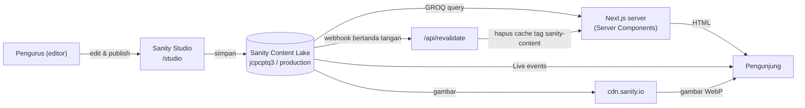

# 01 – Gambaran umum

## Tujuan website

Website ini adalah company profile dan media publikasi resmi BEM FISIP Unpad 2026 (Kabinet Pendar Mentari). Isinya:

- identitas kabinet: logo, visi, misi, budaya kerja, nilai;
- struktur organisasi: Ketua/Wakil, Sekretariat Umum, Bidang, Departemen, Biro, dan seluruh anggota;
- program kerja (proker) tiap unit dan program unggulan;
- Mahasiswa Berprestasi (mapres);
- artikel dan kajian;
- direktori Himpunan/Huria;
- tautan ke kanal resmi (Instagram, TikTok, LinkedIn, YouTube, X, FISIP Care Center).

Pengunjung tidak perlu login. Tidak ada formulir, pembayaran, atau akun anggota. Bahasa utama: Indonesia.

## Teknologi

| Bagian | Teknologi | Versi |
| --- | --- | --- |
| Framework | Next.js (App Router) | 16.3.4 |
| UI | React | 19.2.8 |
| Bahasa | TypeScript (strict) | 5.x |
| Styling | Tailwind CSS | 4.x |
| Animasi | GSAP + `@gsap/react` | 3.x |
| CMS | Sanity (Studio tertanam di `/studio`) | 6.x |
| Integrasi Next–Sanity | `next-sanity` (Live Content API, Studio, webhook) | 13.x |
| Package manager | pnpm | 11.1.2 |
| Runtime | Node.js | 22.18.0 di CI |
| Test | `node:test` lewat `tsx` | — |

Font: Inter (file lokal di `public/fonts/Inter`). Warna brand: biru `#003089` dan kuning `#FFBA3A` (didefinisikan di `app/globals.css` sebagai `brand-blue` dan `brand-yellow`).

> Penting: Next.js 16 punya perubahan besar dibanding versi lama. Sebelum menulis kode, baca panduan di `node_modules/next/dist/docs/` (lihat `AGENTS.md`).

## Arsitektur

Prinsipnya:

1. **Semua konten yang sering berubah ada di Sanity.** Kode hanya menampilkan. Pengecualiannya didaftar di [bab 04](04-model-konten-sanity.md#konten-yang-masih-hardcoded).
2. **Data diambil di server.** Halaman adalah Server Component yang memanggil `sanityFetch` (`sanity/lib/live.ts`). Komponen client (`"use client"`) hanya untuk interaksi: menu HP, carousel, modal, galeri Hima, daftar program.
3. **Hanya konten published dengan `term = "2026"`.** Setiap query memakai parameter `$term` dari `CONTENT_TERM` (`sanity/lib/queries.ts`) dan `perspective: "published"`. Draft dan konten tahun lain tidak pernah tampil.
4. **Gambar langsung dari CDN Sanity.** `components/SanityImage.tsx` meminta gambar yang sudah diperkecil dan dikonversi oleh Sanity (`?w=…&auto=format`), lalu menampilkannya dengan `next/image` `unoptimized`. Gambar tidak diproses ulang oleh server Next.js.

## Alur data dan kesegaran konten

Ada tiga lapis yang membuat konten baru muncul:

| Lapis | Kapan bekerja | Di mana |
| --- | --- | --- |
| Sanity Live | Saat ada pengunjung yang sedang membuka halaman. Browser menerima event dari Sanity dan halaman diperbarui otomatis. | `sanity/lib/live.ts`, `<SanityLive />` di `app/layout.tsx` |
| Cache tag `sanity-content` | Setiap `sanityFetch` diberi tag ini. Cache dibuang saat webhook masuk. | `sanity/lib/cache.ts`, `app/api/revalidate/route.ts` |
| Fetch langsung | Sitemap selalu mengambil data terbaru tanpa cache. | `app/sitemap.ts` |

Detail setup webhook ada di [bab 06](06-deploy-dan-operasional.md#webhook-revalidasi).

Kalau environment Sanity tidak diisi dan proses berjalan di CI (`CI=true`) atau test (`NODE_ENV=test`), `sanityFetch` mengembalikan data kosong. Halaman tetap ter-build dan menampilkan empty state. Di luar CI/test, variabel yang hilang membuat aplikasi berhenti dengan error yang jelas (`sanity/env.ts`).

## Mode render per halaman

Hasil `pnpm build` pada 2026-10-25:

| Route | Mode | Catatan |
| --- | --- | --- |
| `/` | Static (prerender) | Disegarkan oleh Sanity Live dan webhook |
| `/about` | Static | Sama |
| `/hima` | Static | Sama |
| `/studio/[[...tool]]` | Static | Studio berjalan penuh di browser |
| `/article` | Dynamic | Bergantung pada query string `?category=&sort=&page=` |
| `/post/[slug]` | Dynamic | Satu halaman per artikel/kajian |
| `/penjelasan/[birdep]` | Dynamic | Satu halaman per unit organisasi |
| `/sitemap.xml` | Dynamic | `force-dynamic`, selalu data terbaru |
| `/api/revalidate` | Dynamic | Endpoint webhook (POST) |
| `/robots.txt` | Static | |

## Riwayat singkat

- Website 2025 menjadi referensi perilaku. Pertahankan identitas, data, dan desain 2026 yang telah disetujui; perubahan baru mengikuti keputusan maintainer/klien.
- Repositori: `github.com/ptihimatif/bem-fisip-unpad-2026`. Branch utama `main`, integrasi di `dev`, fitur di branch pendek (misalnya `page/about`, `feat/members`) lewat pull request.
- Status handover dan langkah rilis terkini ada di [handover deployment](../HANDOVER_DEPLOYMENT_HEMAT_2026.md). Riwayat kerja lama dapat dipulihkan dari Git atau arsip cleanup lokal.
